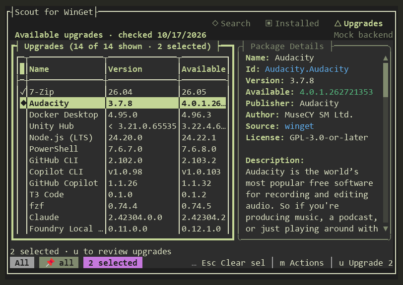
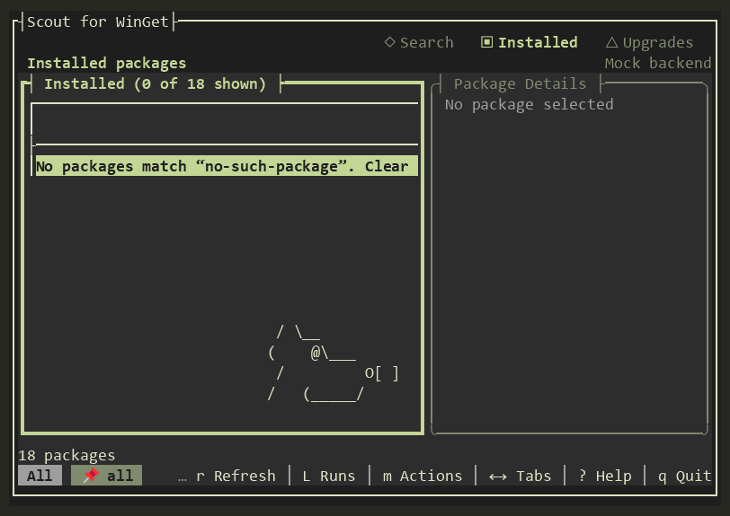
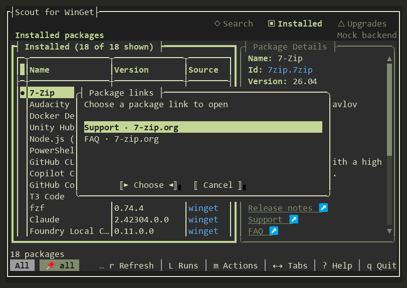

# PR #65 review follow-up

The review was checked against the original request: recover wasted space and
keep everyday package browsing concise. Missing metadata alone is not a reason
to restore it. Reproduction and rendering tests use the project's pinned
Terminal.Gui `2.5.1-develop.170` package.

| Finding | Decision and evidence |
| --- | --- |
| 1. Empty messages inherit the one-cell marker width. | Reproduced and fixed. Clear filled-table styles for the message source, then restore compact styles on refill. ANSI-screen tests cover filled → empty → filled in all three tabs. |
| 2. Secondary links cannot be opened with keys. | Fixed without restoring full URLs. The `m` action menu offers **More links…**, then descriptive labels and hostnames. Keyboard interaction tests open Support, Privacy, Purchase, and documentation through a recording launcher. |
| 3. Same-name review/result rows are ambiguous. | Fixed conditionally. Add source only for name collisions; add ID when packages also share a source. Unique names keep the compact status/name/reason layout. Tests cover both dialogs and mixed source collisions. |
| 4. A “Matched on” category may refer to hidden metadata. | Keep the simplified Details pane. The category describes why WinGet matched a result; it does not promise every raw match value is displayed. Restoring product-code GUIDs, family names, or exhaustive tags would undo the requested simplification. No metadata rows restored. |
| 5. A marked current row loses its cursor marker. | Fixed within the same one-cell gutter: `◆` is current and marked, `✓` is another marked row, and `●` is current and unmarked. Help includes the legend; tests cover marks with Details focused. A recorded checkbox experiment expanded into an emoji despite a text-presentation selector, so the final marker uses a plain diamond. |
| 6. Backend errors are interpreted as Markdown. | Reproduced and fixed. Escape dynamic backend/failure text as literal Markdown. A rendered regression includes paths, underscores, asterisks, entities, link syntax, and a heading-like line. |
| 7. Markdown changes literal link text/destinations. | Fixed. Encode literal labels and safe markup destinations, and launch the original captured URL rather than the parser's decoded value. Mouse regressions verify literal entity text and exact destinations containing entities/backslashes. |
| 8. Run and Cancel overlap on the first layout pass. | Not reproduced on the pinned package. Actual ANSI first-render tests at 80, 100, and 140 columns pass with the existing placement. Retain that implementation and the regression tests. |
| 9. Mock versions are not newest first. | Fixed sorting of observed values, including Discord's newer installed version. Do not invent release histories to fill the picker: this fixture represents live observations, and controlled backend tests exercise specific-version workflows. |
| 10. Source returns too early in narrow Upgrades panes. | Reproduced and fixed. Reserve useful version/name widths before showing Source. Regression widths are 81, 84, and 87 columns. |
| 11. The rose screenshot assertion uses a truncated name. | Use the stable `Microsoft.VisualStudioCode` ID. Run the complete capture script in an ignored output mirror to verify the new fixture without replacing published site media. |
| 12. Mixed status lengths misalign package names. | Pad only to the longest status in that dialog. This restores alignment without reserving arbitrary name padding. A READY/SKIP regression checks name starts. |
| 13. Mock sessions share mutable catalog objects. | Each backend now deserializes a separate embedded snapshot. Mutation-isolation coverage verifies separate objects and arrays. |
| 14. Two cell-width clipping implementations differ. | Share a text-element-aware prefix helper; ellipsis clipping explicitly reserves one cell. Existing rendered long-token coverage remains. |
| 15. Count and marker selection mappings are duplicated. | Both now use `CurrentSelectionKeys()`. Existing hidden-selection, count, and marker interaction tests remain. |

## Validation

- All 749 tests passed, including 26 new rendered/driverless review regressions.
- ARM64 Native AOT publishing passed with locked restore. The final executable's
  smoke check and main-thread/thread-pool COM activation passed (three catalogs).
- All four site screenshot assertions passed, including the rose ID assertion;
  both mock demo GIF recordings completed in an ignored output mirror.
- Final-executable 80×24 PTY captures passed assertions for the marked current
  row, a no-match filter after a filled list, and keyboard access to secondary
  links. The diamond capture was visually checked for one-cell alignment.
- Site validation passed for 15 files; `git diff --check` passed.

## Recorded compact previews

These mock captures perform no live package changes. The secondary-link picker
was reached with `m`, End, Up, Up, Enter; no link was opened by the capture.

Recorded PTY output and in-process ANSI tests do not establish native Windows
Terminal keyboard/mouse behavior. That limitation from the original
[UX audit](ux-audit-2026-10-24.md) remains. No live package-changing operation is
used for this review.
