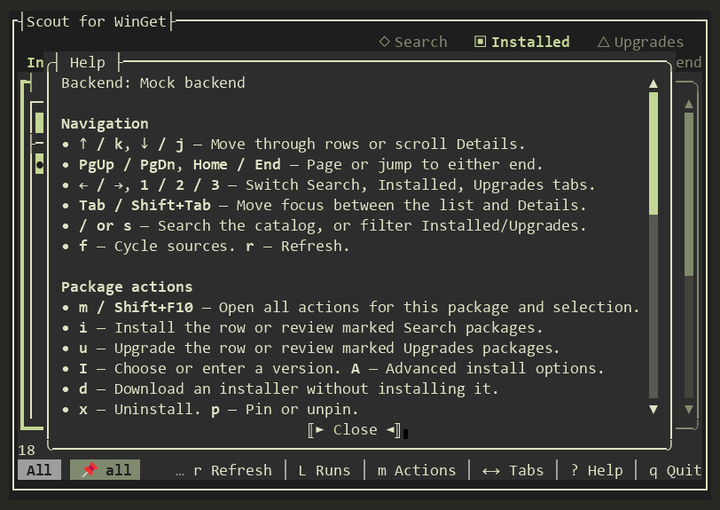
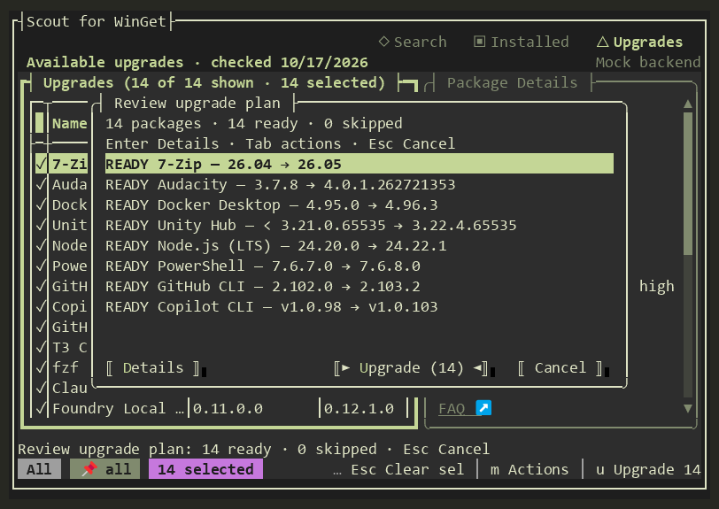

# UX audit: October 24, 2026

## Scope and method

Reviewed package lists, Details, contextual actions, upgrade review, advanced
install options, Help, diagnostics, and the minimum-size guard. Recorded mock
interactions at 140×34 and 80×24, plus a 79×23 guard check. Rendered regressions
also cover widths 80, 100, 120, 140, and 190 and modal resizing.

The live pass used only installed/upgrade inventory, catalog searches, package
details, source queries, and diagnostics. Live captures included COM upgrades
and a 7-Zip search at 100×32, an inventory of 320 installed entries, and successful
read-only queries of `msstore`, `winget`, and `winget-font`. Package-changing workflows used mock/recording
backends. Inventory exports and public catalog details supplied the richer
[mock fixture](../src/MockData/README.md).

Evidence consists of recorded PTY frames/PNGs under `publish/ux-audit/` and
automated ANSI-screen/driverless interaction regressions. These do not establish
actual Windows Terminal keyboard or mouse behavior. Windows Terminal processes
were present, but the computer-use tool returned no targetable terminal windows;
no native GUI input was attempted.

## Compact-screen previews

These 80×24 captures use the frozen mock catalog and perform no live package
changes. Help wraps vertically, and review rows keep version changes visible.

## Findings and changes

| Observed issue | Change |
| --- | --- |
| Source expanded to 15–22 cells for short values while names were truncated. | Keep Source at eight cells, reserve only the measured rendering gutter, and give spare width to Name. |
| The first width adjustment restored Id prematurely in compact Search. | Keep the compact breakpoint until package names have enough room; cover the 100-column case explicitly. |
| Long URLs occupied multiple rows and introduced nested scrollbars. | Display descriptive link labels while preserving the full destination. Mouse-click regression verifies the complete URL, including parentheses and query parameters. |
| 7-Zip's duplicate author, copyright, and many tags pushed its description out of the initial compact view. | Show descriptions earlier; omit duplicate author/version values, copyright, family names, and tag lists in Installed/Upgrades. Search retains three tags plus a remaining count. |
| Long IDs or paths with no spaces lost their trailing text. | Wrap whole tokens across rows at text-element boundaries. |
| Compact Help required horizontal scrolling to read ordinary instructions. | Use wrapping Markdown, a larger modal, stable vertical scrolling, and clearer action/review language. |
| Review/result rows repeated ID and source before the version change or failure reason. | Prioritize status, name, and reason; adapt to the available width. Full identity/source stay in Details. |
| Review buttons could crowd one another. | Position the primary action relative to the right-aligned Cancel button; test for intersecting button bounds. |
| “Toggle All,” “selected if marked,” and “1 packages” were misleading or awkward. | Say visible marks, distinguish row actions from reviewing marks, and use singular wording for one package. |
| Synthetic mock records were sparse, outdated, and duplicated VS Code search results. | Embed 23 unique real catalog snapshots, preserving installed/catalog version differences and returning isolated copies. |

## Checks retained

Regression coverage includes row navigation and marks, hidden selections,
selection counts, dialog buttons after resizing, reviewed retries, Help
scrolling and read-only text, compact links and click targets, partial redraws,
long ID wrapping, and visible installed/available versions. Advanced install
controls and the terminal-size guard were inspected without package changes.

Validation passed: 723 automated tests, ARM64 Native AOT publishing with locked
restore, smoke execution, COM activation on the main thread and thread pool,
site validation, and recorded before/after mock and live read-only frames.

## Follow-up observation

The live COM engine listed 13 upgrade candidates while the newer WinGet CLI
listed 14; Copilot CLI (`GitHub.Copilot`) was the extra CLI candidate. The
snapshot records the CLI observation. This audit does not resolve why those
engines disagree or change upgrade eligibility rules.
